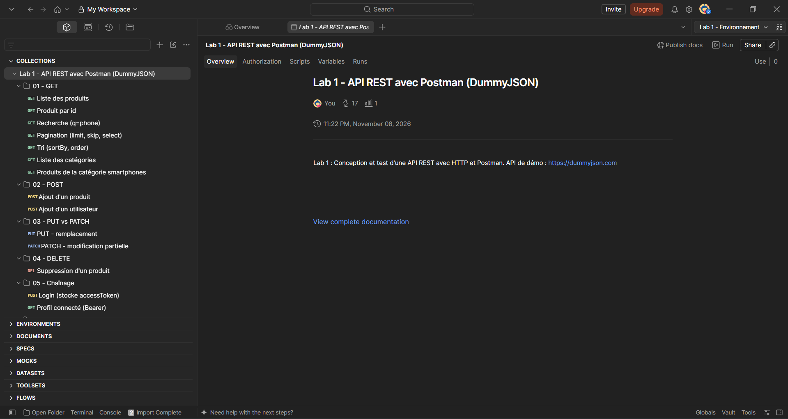
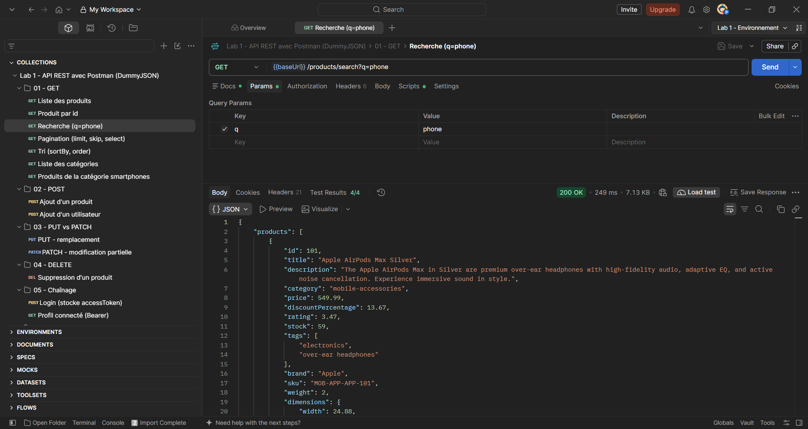
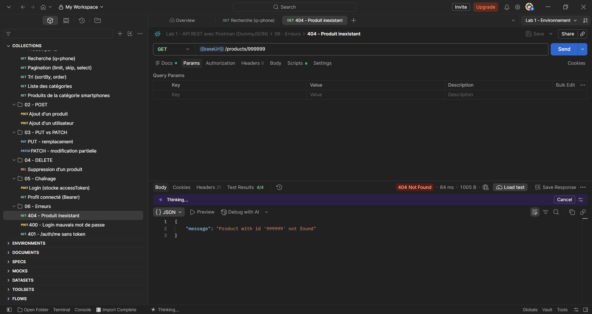
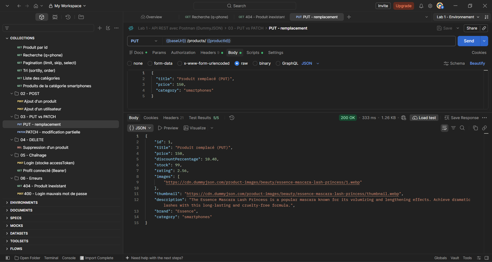
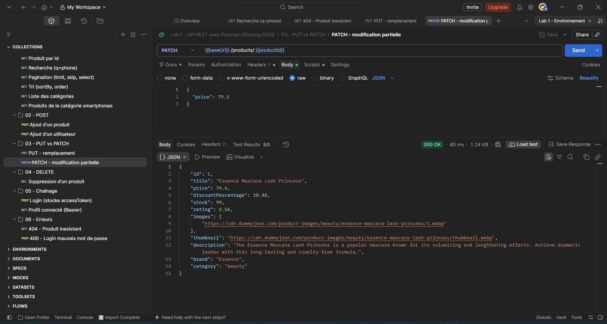
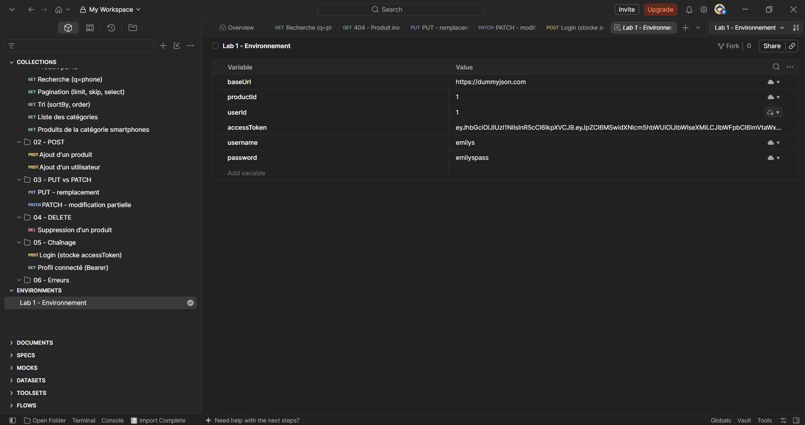
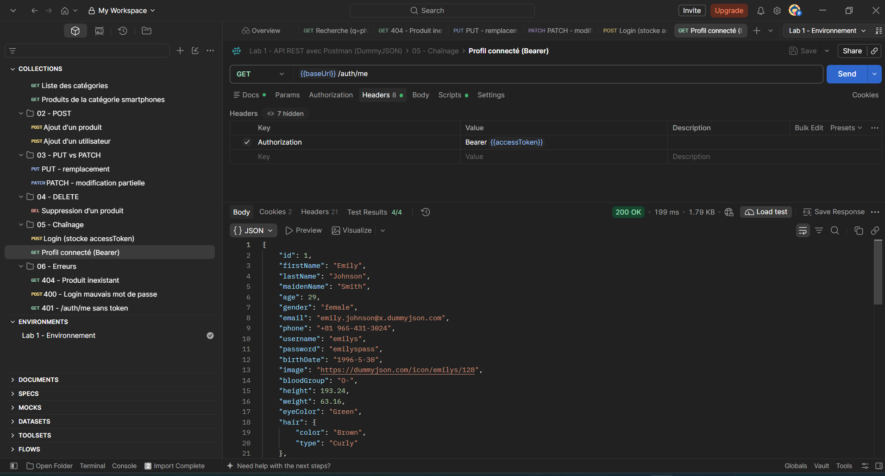
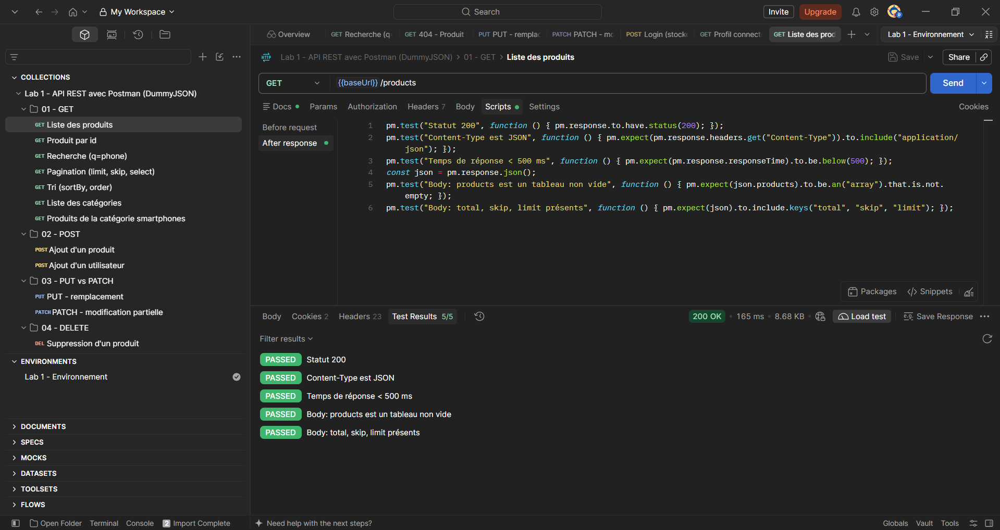
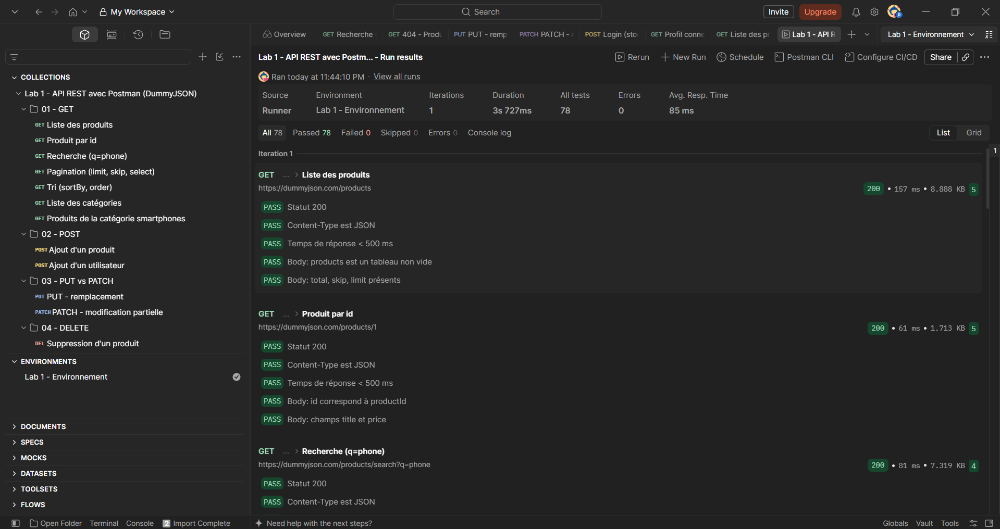

# Lab 1 : Conception et test d'une API REST avec HTTP et Postman

Cours : Développement Backend avec Java, Node.js et PHP
Nom : Abdellah Achakaj
Master IAIDDWM - FST Marrakech
Date : 8 novembre 2026

---

## 1. Introduction

HTTP est le protocole utilisé pour échanger des données sur le Web. Le client envoie une requête (méthode, URL, en-têtes, corps) et le serveur répond avec un code de statut et un corps.

Une API REST représente chaque ressource (produit, utilisateur) par une URL et utilise les méthodes HTTP : GET pour lire, POST pour créer, PUT et PATCH pour modifier, DELETE pour supprimer. Les données sont échangées en JSON, un format texte simple (clé : valeur).

Dans ce lab, j'ai utilisé Postman pour tester l'API de démonstration https://dummyjson.com, puis Newman pour lancer la collection en ligne de commande. Les écritures de cette API sont simulées : rien n'est vraiment modifié sur le serveur.



## 2. Tableau des requêtes

La collection contient 17 requêtes dans 6 dossiers. Toutes utilisent la variable {{baseUrl}} (https://dummyjson.com).

| Méthode | URL | Statut | Rôle |
|---|---|---|---|
| GET | /products | 200 | Liste des produits |
| GET | /products/{{productId}} | 200 | Produit par id |
| GET | /products/search?q=phone | 200 | Recherche |
| GET | /products?limit=5&skip=10&select=title,price | 200 | Pagination |
| GET | /products?sortBy=price&order=asc&limit=10 | 200 | Tri par prix |
| GET | /products/categories | 200 | Liste des catégories |
| GET | /products/category/smartphones | 200 | Produits d'une catégorie |
| POST | /products/add | 201 | Ajout d'un produit |
| POST | /users/add | 201 | Ajout d'un utilisateur |
| PUT | /products/{{productId}} | 200 | Remplacement d'un produit |
| PATCH | /products/{{productId}} | 200 | Modification partielle |
| DELETE | /products/{{productId}} | 200 | Suppression d'un produit |
| POST | /auth/login | 200 | Connexion, récupération du token |
| GET | /auth/me | 200 | Profil de l'utilisateur connecté |
| GET | /products/999999 | 404 | Produit inexistant |
| POST | /auth/login | 400 | Mauvais mot de passe |
| GET | /auth/me | 401 | Appel sans token |



## 3. Codes HTTP rencontrés

| Code | Signification | Exemple obtenu |
|---|---|---|
| 200 OK | La requête a réussi | GET /products/1 renvoie le produit d'id 1 |
| 201 Created | Une ressource a été créée | POST /products/add renvoie {"id":195,"title":"Lab1 Produit Test",...} |
| 400 Bad Request | Requête incorrecte | Login avec un mauvais mot de passe : {"message":"Invalid credentials"} |
| 401 Unauthorized | Pas authentifié | GET /auth/me sans token : {"message":"Access Token is required"} |
| 404 Not Found | Ressource introuvable | GET /products/999999 : {"message":"Product with id '999999' not found"} |

Les codes 2xx indiquent un succès, les codes 4xx une erreur du client et les codes 5xx une erreur du serveur.



## 4. PUT vs PATCH

- PUT remplace la ressource en entier : on envoie tous les champs.
- PATCH modifie seulement les champs envoyés, les autres ne changent pas.

Dans mes tests, le PUT envoie {"title":"Produit remplacé (PUT)","price":150,"category":"smartphones"} et la réponse contient le nouveau titre. Le PATCH envoie seulement {"price":79.5} : le prix change mais le titre reste "Essence Mascara Lash Princess".





## 5. Variables d'environnement et chaînage

L'environnement contient les variables baseUrl, productId, userId, accessToken (vide au départ), username et password. Elles évitent d'écrire les valeurs en dur dans les requêtes.

Le chaînage se fait en trois étapes :

1. POST /auth/login avec username et password : la réponse contient un accessToken.
2. Le script de test enregistre le token avec pm.environment.set("accessToken", json.accessToken).
3. GET /auth/me envoie l'en-tête Authorization: Bearer {{accessToken}} et renvoie le profil de l'utilisateur.





Remarque : après le login, Newman garde un cookie accessToken envoyé par le serveur. Pour que la requête 401 soit vraiment sans token, j'ai ajouté un en-tête Cookie vide dans cette requête.

## 6. Scripts de test

Chaque requête a des tests JavaScript dans l'onglet Scripts. Exemple utilisé dans toutes les requêtes :

```javascript
pm.test("Statut 200", function () {
  pm.response.to.have.status(200);
});
pm.test("Content-Type est JSON", function () {
  pm.expect(pm.response.headers.get("Content-Type"))
    .to.include("application/json");
});
pm.test("Temps de réponse < 500 ms", function () {
  pm.expect(pm.response.responseTime).to.be.below(500);
});
```

Pour le login, le test vérifie le token et le stocke :

```javascript
const json = pm.response.json();
pm.test("Body: accessToken présent", function () {
  pm.expect(json.accessToken).to.be.a("string").and.not.empty;
});
pm.environment.set("accessToken", json.accessToken);
```

Pour la suppression, on vérifie isDeleted :

```javascript
pm.test("Body: isDeleted est true", function () {
  pm.expect(json.isDeleted).to.be.true;
});
```



## 7. Résultats Newman

Commande utilisée :

```
newman run postman/lab1-collection.postman_collection.json -e postman/lab1-env.postman_environment.json -r cli,htmlextra
```

| | Résultat |
|---|---|
| Requêtes | 17 (0 échec) |
| Assertions | 78 (0 échec) |
| Temps de réponse moyen | 131 ms |
| Min / max | 79 ms / 390 ms |

Tout passe à 100 %. Le test du temps de réponse (< 500 ms) dépend du réseau : certaines exécutions ont eu un dépassement ponctuel, il suffisait de relancer. Dans le Collection Runner de Postman, j'ai aussi obtenu 78 tests réussis sur 78 (temps moyen 85 ms). Le rapport complet est dans newman/newman-report.html.



## 8. Conclusion

Ce lab m'a permis de tester les méthodes GET, POST, PUT, PATCH et DELETE, de comprendre les codes 200, 201, 400, 401 et 404 et la différence entre PUT et PATCH. J'ai aussi appris à utiliser les variables d'environnement, à enchaîner deux requêtes avec un token et à automatiser les tests avec Newman.
